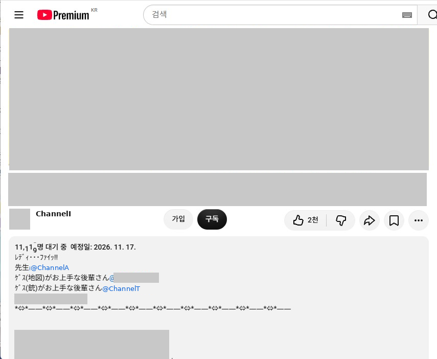
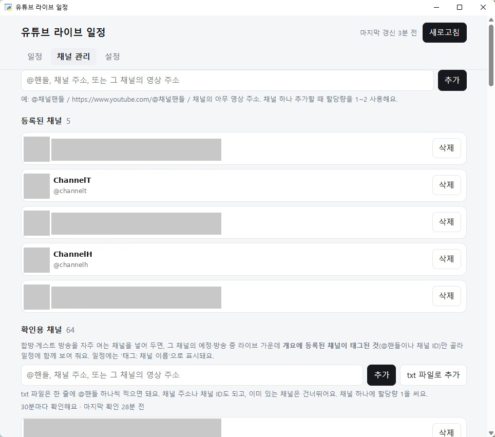
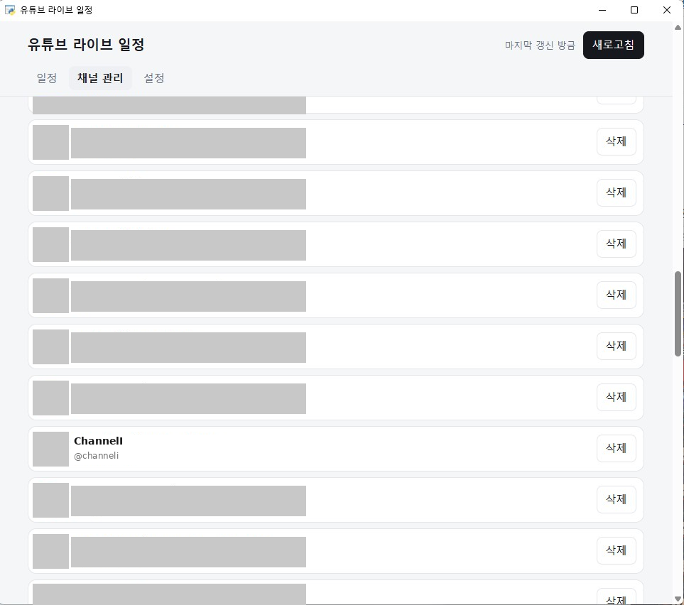
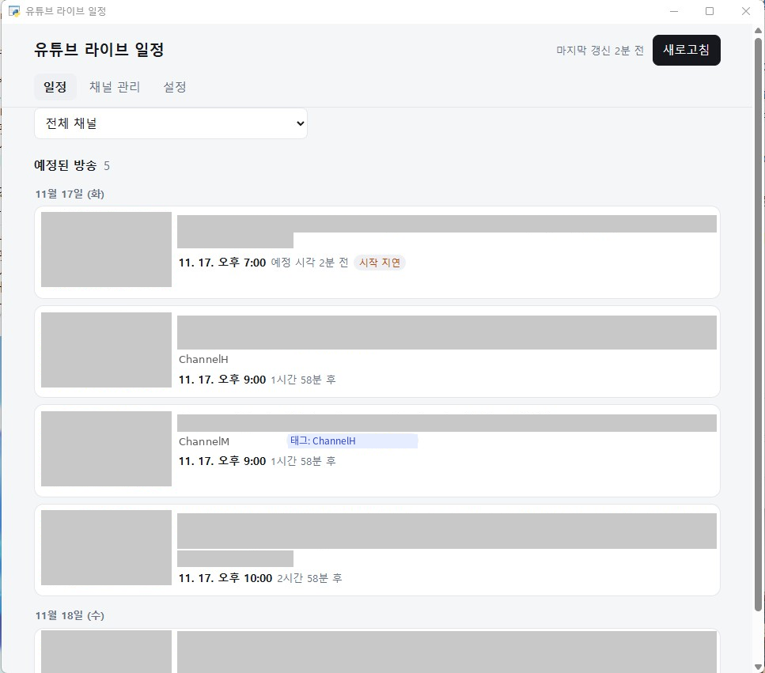
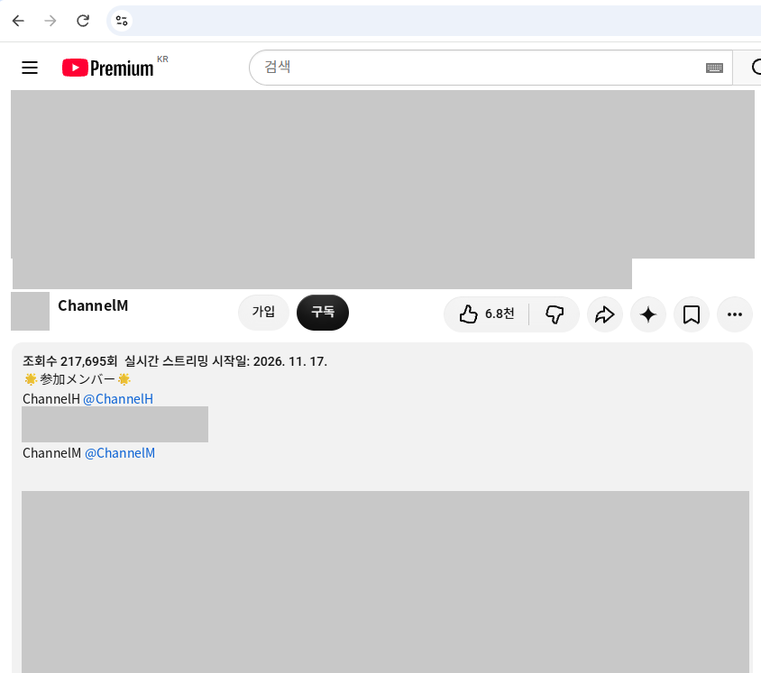

# I-01 · 개요란에 @핸들 바로 앞에 가나가 붙어있으면 태그된 방송으로 찾지 못 한다

[이슈 목록](../issues.md)

> 채널명·핸들은 가명. 기준은 [이슈 목록](../issues.md) 참고.

## 요약

| 항목 | 내용 |
|---|---|
| ID | I-01 |
| 유형 | 버그 |
| 분류 | 확인용 채널 |
| 관련 요구사항 | F-42 |
| 심각도 | 보통 |
| 우선순위 | 높음 |
| 재현 | 항상 |
| 발견 버전 | 2026-11-06 빌드 |
| 발견일 | 2026-11-17 |
| 환경 | Windows 11 Home, Python 3.15.1, pywebview 6.2.1 |
| 진행 상황 | [GitHub #1](https://github.com/ner0128/youtube-live-schedule/issues/1) |

## 재현 조건

- 등록 채널에 ChannelT(`@channelt`)가 있음
- 확인용 채널에 ChannelI(`@channeli`)가 있음
- ChannelI의 예정 라이브 개요란에 ChannelT의 핸들이 있고 핸들의 '@' 바로 앞에 공백 없이 가나가 붙어있음 (예: `後輩さん@ChannelT`)

## 재현 절차

1. 확인용 채널에 대한 확인을 수행 (새로고침 혹은 새로고침 주기 대기)
2. 일정 탭의 예정된 방송 항목에 조건에 맞는 라이브가 표시되는지 확인

## 기대 결과

- ChannelI 방송이 '태그: ChannelT'로 일정 탭에 표시됨

## 실제 결과

- 해당 라이브 일정이 일정 탭에 정상적으로 표시되지 않음

## 원인 (추정)

- 등록된 채널 핸들이 포함된 다른 채널에 대한 결과가 표시되지 않도록 하는 경계 검사가 핸들의 '@' 앞에도 적용되어 해당 채널의 핸들로 인식되지 않음

## 조치안

- 경계 검사를 '@' 앞쪽에는 적용하지 않고 뒤쪽에만 적용함
- live_schedule.py 331줄 `(?<![\w.@-])` 제거

## 비고

- '@' 앞에 공백이 있는 태그는 정상적으로 인식됨
- 같은 날 ChannelM 방송은 개요에 `ChannelH @ChannelH`로 적혀 있고 'ChannelH 태그'로 인식되어 정상적으로 표시됨 ([개요](../images/issues/I-01_description_ok.png), [일정 탭](../images/issues/I-01_schedule.png))
- 일본어 가나 외의 문자(영어, 한글 등)에 대해서도 확인 필요

## 첨부

